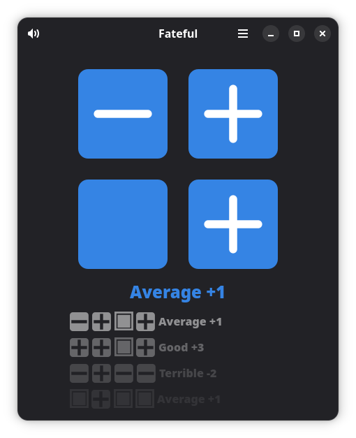
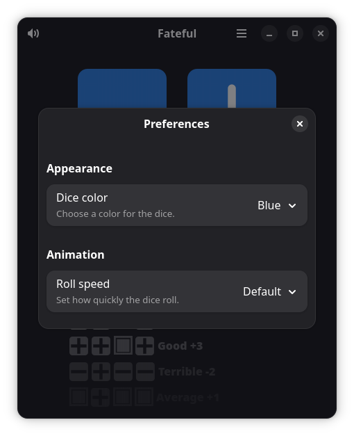

<p align="center">
  
</p>

<h1 align="center">Fateful</h1>

<p align="center">A small desktop roller for Fate dice.</p>

Fateful rolls four Fate dice, animates each die, and shows the total with its Fate ladder descriptor. Click any die or press **Space** to roll. The four most recent results stay visible for the current app session.

## Preview

<p align="center">
  
  
</p>

## Features

- Roll four Fate dice with animated, independently moving dice.
- See the total and its Fate ladder descriptor.
- Review up to four recent rolls, including each die's face.
- Choose a dice color or follow the system accent color.
- Adjust roll animation speed, including instant rolls.
- Mute or unmute randomized dice sounds.
- Use the app in a compact GTK 4 and libadwaita window.

## Build and run

Fateful is packaged as a Flatpak and uses the GNOME 51 runtime. Install Flatpak, Flatpak Builder, and the GNOME 51 SDK/runtime, then run these commands from the project directory:

```sh
flatpak-builder --user --install --force-clean .flatpak/build-dir io.github.trunar.Fateful.json
flatpak run io.github.trunar.Fateful
```

## Install

Install Flatpak and configure the Flathub remote for the GNOME runtime. Download the latest `.flatpak` bundle from [GitHub Releases](https://github.com/trunar/Fateful/releases/latest), then install and launch it:

```sh
flatpak install --user ./Fateful-<version>-x86_64.flatpak
flatpak run io.github.trunar.Fateful
```

## About and legal

Fateful is developed by Andrii Indyk and is licensed under the **MIT License**. See [`COPYING`](COPYING).

Fateful was inspired in large part by [Fate Dice by VH-Labs](https://play.google.com/store/apps/details?id=com.rpgautomails.fatedice&hl=en-US).

Dice sounds are by **Wuzzy** and are dedicated to the public domain under **CC0 1.0**. They are from [Wooden dice on wooden table roll](https://opengameart.org/content/wooden-dice-on-wodden-table-roll).

The bundled **Fate Core Font** is © 2012 Evil Hat Productions, LLC, and is used with permission. Its embedded copyright notice names Fred Hicks and Jeremy Keller; the Four Actions icons were designed by Jeremy Keller. See [`FONT-COPYRIGHT.txt`](data/fonts/FONT-COPYRIGHT.txt) and [Fate's official licensing page](https://fate-srd.com/official-licensing-fate).

## AI assistance

OpenAI Codex assisted substantially with implementation and iteration across the user interface, dice animations, sound handling, preferences, Flatpak packaging, and documentation. The developer is responsible for the project and its releases.
